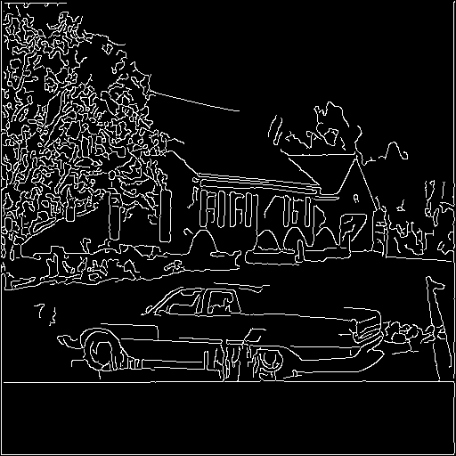
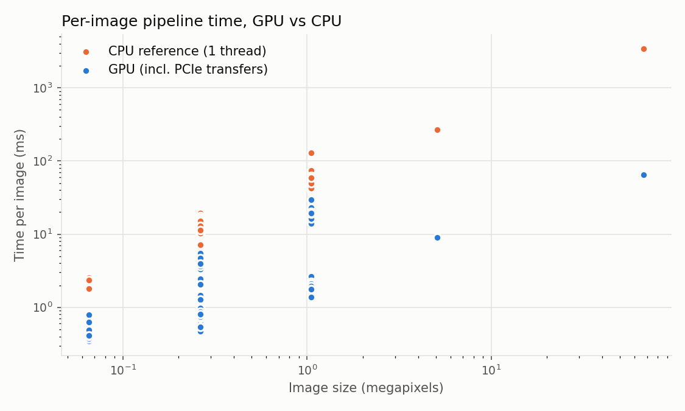
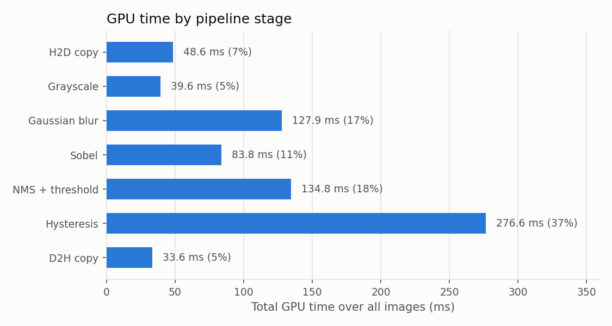
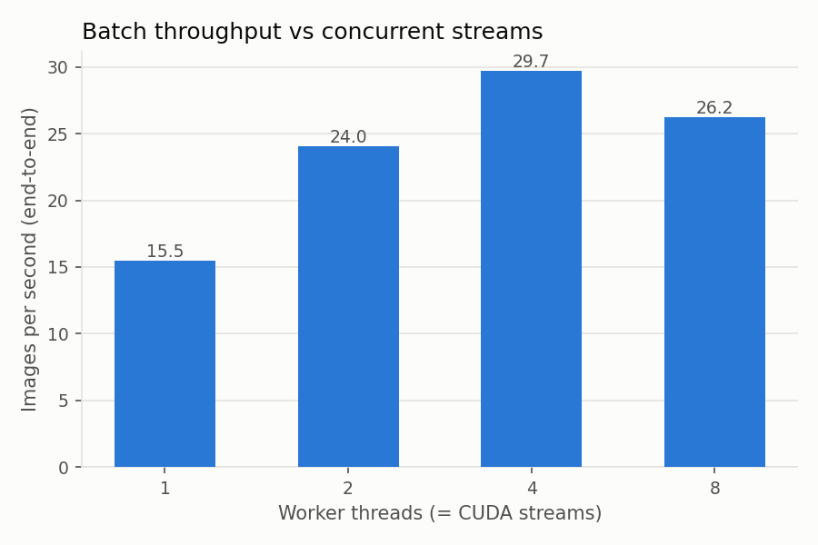
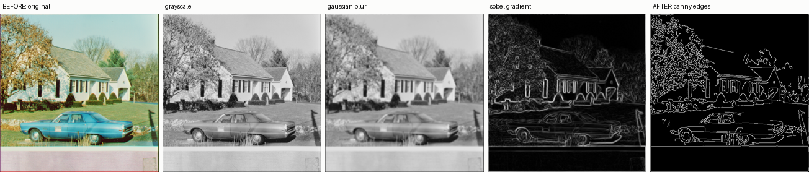
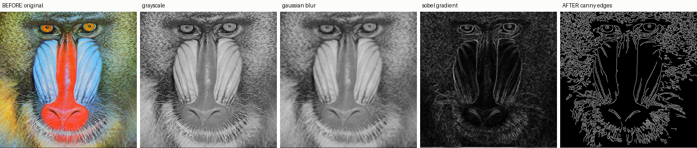
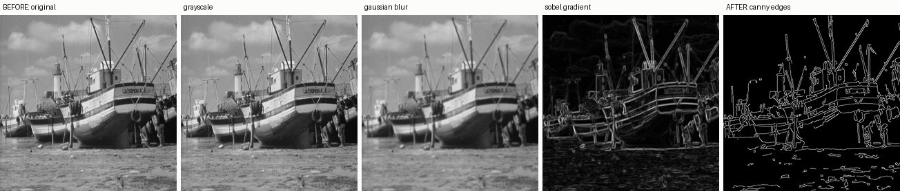
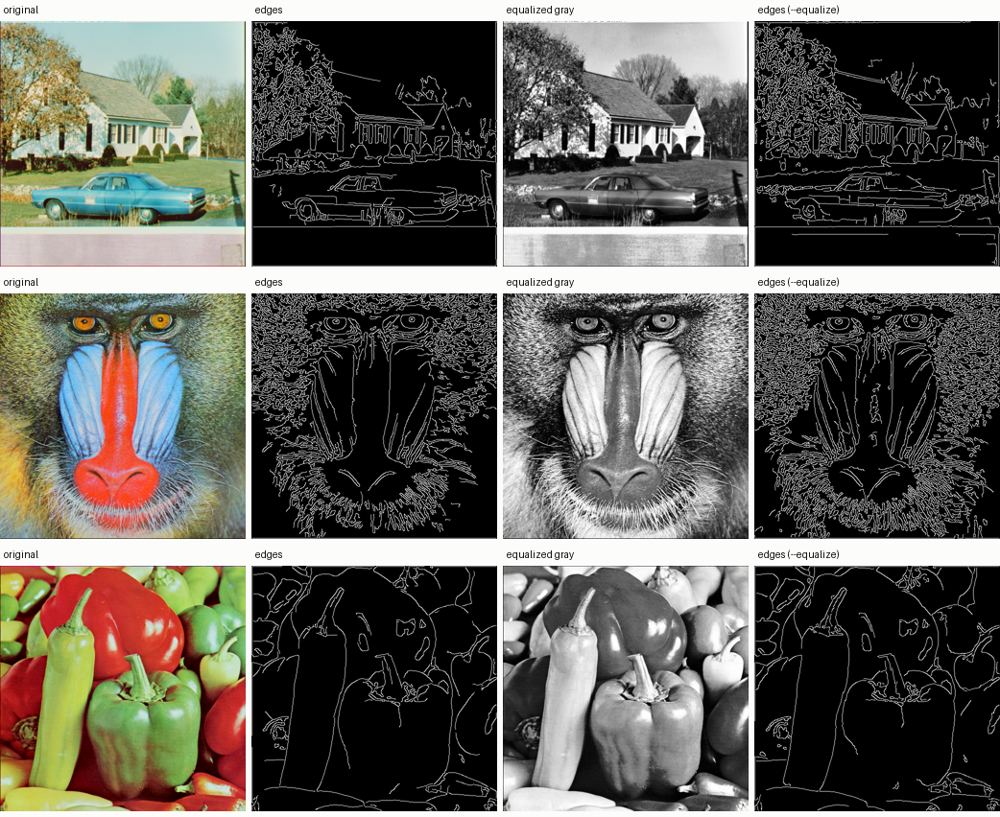

# CUDA Canny: Batch GPU Edge Detection with Bit-Exact CPU Verification

GPU Specialization capstone project. `cuda_canny` is a command-line tool that
runs a full **Canny edge detection pipeline**, with optional **histogram
equalization**, on large batches of images. Every stage is a hand-written CUDA
kernel. A single-threaded CPU reference implementation checks the GPU output
**pixel for pixel**. It also serves as the baseline for speedup measurements.

The tool was run on **142 images / 148 megapixels**: the USC-SIPI *misc*,
*textures* and *aerials* volumes plus one 8192 × 8192 synthetic image. All of
them matched the CPU reference exactly (0 mismatched pixels). See
[Results](#results).

| Before | After |
|---|---|
|  |  |

---

## Pipeline and the GPU techniques it uses

```
 RGB ─▶ gray ─▶ [histogram ─▶ CDF scan ─▶ LUT] ─▶ Gaussian rows ─▶ Gaussian cols
      ─▶ Sobel |∇|,θ ─▶ non-max suppression + max reduction ─▶ double threshold
      ─▶ iterative hysteresis ─▶ binary edge map
```

| Stage | Kernel(s) | CUDA technique |
|---|---|---|
| Grayscale | `GrayscaleKernel` | grid-stride loop, integer BT.601 luma |
| Histogram equalization (`--equalize`) | `HistogramKernel`, `EqualizeLutKernel`, `ApplyLutKernel` | privatized **shared-memory atomics**, Hillis-Steele **block scan** for the CDF, LUT cached in shared memory |
| Gaussian blur | `GaussianRowsKernel`, `GaussianColumnsKernel` | separable filter, weights in **`__constant__` memory**, **shared-memory tiles with halos** (dynamic shared memory sized by σ) |
| Sobel gradient | `SobelKernel` | read-only cache (`__ldg`), atan2-free direction binning |
| Non-max suppression | `NonMaxSuppressionKernel` | fused with a **warp-shuffle max reduction** + global `atomicMax` on float bits |
| Double threshold | `ThresholdKernel` | thresholds computed on the device from the reduced max (no host round trip) |
| Hysteresis | `HysteresisKernel<Tile>` | shared-memory tile + halo, in-block propagation with **`__syncthreads_or`**, host relaunch until convergence, **active-tile work skipping** (ping-pong flags), tile size picked per image via a template parameter |
| Batch driver | `main.cc` | N host threads, each with its own **CUDA stream**, **pinned host buffers** and device buffers, so decoding, transfers and kernels of different images overlap |

Timing uses **CUDA events** at every stage boundary, so each run reports
H2D / gray / blur / sobel / NMS / hysteresis / D2H times.

### Why the GPU and CPU outputs match exactly

All per-pixel math (luma, Sobel, direction binning, NMS test, threshold
classification, equalization LUT) lives in one header,
[src/pixel_ops.h](src/pixel_ops.h). It is compiled as `__host__ __device__`
and used by both implementations. Fused multiply-add is disabled on both sides
(`-fmad=false` for nvcc, `-ffp-contract=off` for g++), and angles are binned
by comparing against tan(22.5°) and tan(67.5°) instead of calling `atan2`. As
a result, the float math runs the same operations in the same order on both
sides. The hysteresis fixpoint is unique, so the GPU's iterative result equals
the CPU's flood fill. This makes `--verify` a strict test that every pixel is
identical, with no tolerance.

---

## Repository layout

```
src/
  main.cc           CLI driver: file discovery, worker threads, logging, CSV
  cli_options.*     command-line parsing and validation
  canny_gpu.cu/.h   CUDA kernels + GpuCanny class (stream, buffers, timing)
  canny_cpu.*       CPU reference implementation
  pixel_ops.h       __host__ __device__ math shared by GPU and CPU
  canny_types.*     params, image/result/timing structs, Gaussian weights
  image_io.*        PNG/JPG/BMP/PGM loading and PNG saving (stb)
  cuda_check.h      CUDA error-checking macros
third_party/        stb_image.h, stb_image_write.h (public domain)
scripts/
  fetch_data.sh     downloads SIPI volumes, converts TIFF->PNG, makes synthetic image
  convert_images.py TIFF->PNG conversion and synthetic image generator
  make_report.py    figures + summary table from the CSV/logs
  package_proof.sh  zips results/ into proof_of_execution.zip
docs/               presentation script and submission text
data/input/misc/    SIPI misc volume as PNG (committed; other volumes are downloaded)
results/            proof of execution: logs, CSVs, edge maps, stage images, figures
Makefile, run.sh    build and end-to-end demo
```

---

## Requirements and installation

* NVIDIA GPU with compute capability 6.0 or newer, plus a matching driver.
* CUDA Toolkit 11.x or 12.x (`nvcc`). Tested with **CUDA 12.6**.
* `g++` with C++17 support and `make`.
* Python 3 with `numpy`, `Pillow`, `matplotlib`. These are only needed for the
  data preparation and report scripts: `pip install -r requirements.txt`.

Ubuntu or the Coursera lab:

```bash
sudo apt-get install -y build-essential curl python3-pip   # if missing
pip install -r requirements.txt
make                       # builds bin/cuda_canny
```

Windows: build inside **WSL2 (Ubuntu)** with the CUDA toolkit for WSL
installed. The Windows NVIDIA driver exposes the GPU to WSL automatically.
That is how the results in this repository were produced.

If CUDA is not at `/usr/local/cuda`, or you want to build only for your own
GPU (faster):

```bash
make CUDA_PATH=/usr/local/cuda-12.6 GENCODE="-arch=sm_75"
```

## Getting the data

```bash
./scripts/fetch_data.sh          # misc + textures + aerials + 8192x8192 synthetic
./scripts/fetch_data.sh misc     # only the small misc volume
```

The script downloads the volumes from the
[USC-SIPI Image Database](https://sipi.usc.edu/database/database.php) and
converts the TIFF files to PNG under `data/input/<volume>/`. It also generates
a 67-megapixel synthetic test image. The *misc* volume is already committed,
so the program can run straight after cloning.

## Running

```bash
./run.sh            # full demo: build, data, verification, scaling, figures
QUICK=1 ./run.sh    # misc volume only (smoke test)
```

Or call the binary directly:

```bash
./bin/cuda_canny --input data/input/misc --output results/misc --verify --save-stages
./bin/cuda_canny --input photo.jpg --output out --sigma 2.0 --low 0.05 --high 0.2
./bin/cuda_canny --input data/input --workers 4 --quiet
```

### Command-line arguments

| Flag | Default | Meaning |
|---|---|---|
| `-i, --input PATH` | *(required)* | image file, or directory searched recursively |
| `-o, --output DIR` | `data/output` | where `<name>_edges.png` files are written |
| `--csv PATH` | `<output>/results.csv` | per-image metrics |
| `--sigma F` | `1.4` | Gaussian σ in pixels, (0, 5] |
| `--low F` / `--high F` | `0.10` / `0.25` | hysteresis thresholds as fractions of the max gradient |
| `--equalize` | off | histogram-equalize before edge detection |
| `-w, --workers N` | `2` | concurrent host threads, one CUDA stream each |
| `--device N` | `0` | CUDA device |
| `-n, --max-images N` | all | limit the number of images |
| `-r, --repeat N` | `1` | run the GPU pipeline N times per image, report the fastest |
| `--verify` | off | run the CPU reference, compare every pixel, report speedup |
| `--save-stages` | off | also write `_1_gray`, `_2_blur`, `_3_gradient` images |
| `--quiet` | off | print only the summary |

Exit codes: `0` success, `1` usage error or no inputs, `2` some image failed,
`3` verification found mismatches.

### Output

* `<output>/<name>_edges.png` is the binary edge map (and the stage images
  with `--save-stages`).
* `<output>/results.csv` has one row per image: size, load time, per-stage GPU
  times, hysteresis passes, edge pixel count, CPU time, speedup and mismatched
  pixels.
* stdout shows a per-image log line and a summary block (throughput, stage
  totals, speedup, verification verdict).

---

## Results

Hardware: **NVIDIA GeForce RTX 2050 laptop GPU** (Ampere, 16 SMs, 4 GB,
compute 8.6), CUDA 12.6 in WSL2 Ubuntu 22.04. The CPU reference is
single-threaded C++ built with `-O3`. Everything below was produced by
`./run.sh`. Raw logs are in [results/logs/](results/logs/) and per-image CSVs
in `results/*/results.csv`.

### Correctness

| Run | Images | Megapixels | Mismatched pixels |
|---|---|---|---|
| misc volume, `--save-stages` | 39 | 9.8 | **0** |
| whole dataset (misc + textures + aerials + 8192² synthetic) | 142 | 147.8 | **0** |

### Speed (GPU time includes host↔device copies)

| | GPU | CPU reference | Speedup |
|---|---|---|---|
| 8192 × 8192 synthetic (67 MP) | **64 ms** | 3 429 ms | **53×** |
| All 142 images | 745 ms | 7 302 ms | 9.8× |
| misc volume (mostly 512²) | 37 ms | 413 ms | 11.2× |

Small 512 × 512 images give a smaller speedup: there is too little work to
fill the GPU, and the fixed per-launch and per-sync costs dominate. Timings in
`--verify` mode are conservative, because the laptop GPU lowers its clocks
while the CPU reference runs. Without `--verify`, the GPU processes the whole
dataset at about **370 MP/s** of kernel throughput.



### Where the GPU time goes



Blur, Sobel and NMS are memory-bandwidth-bound and very fast: blurring the
67 MP image takes about 12 ms. **Hysteresis is the hard part.** Edge
connectivity is a global property, but a kernel can only propagate it within
a tile per launch. The first version used 16 × 16 tiles and needed 84
relaunches on the 8192² image: 272 ms, about 90% of GPU time. Two changes fixed
that:

1. **Active-tile skipping.** A block exits immediately unless it or one of
   its neighbours changed in the previous pass.
2. **Larger tiles with several pixels per thread.** Each sweep can propagate
   several steps.

Hysteresis on the 8192² image dropped from **272 ms to 16 ms (17×)**. 64 px
tiles were *slower* on 512² images (too few blocks to fill 16 SMs), so the
tile size is a template parameter chosen per image: 64 px for 16 MP and
above, otherwise 32 px.

### Concurrency (CUDA streams + worker threads, 142 images, end-to-end incl. PNG decode/encode)

| Workers / streams | 1 | 2 | 4 | 8 |
|---|---|---|---|---|
| Images per second | 15.5 | 24.0 | **29.7** | 26.2 |



End to end, the job is CPU-bound by PNG decoding and encoding. Overlapping
several images, each on its own stream, nearly doubles throughput. Eight
workers is slower than four because the laptop has fewer free cores and the
streams start competing for the GPU.

### Before / after





Histogram equalization (`--equalize`) recovers edges in dark or low-contrast
regions:



### Lessons learned

* **Design for a bit-exact check from the start.** nvcc fuses multiply-adds
  by default, and `atan2f` can differ from glibc in the last bit. Either one
  can flip a pixel that sits on a threshold. One shared `__host__ __device__`
  header, `-fmad=false`, and comparisons instead of `atan2` made the
  comparison exact on all 142 images. That is much stronger evidence of
  correctness than a "looks similar" tolerance.
* **Measure per stage before optimizing.** Before the per-stage event
  timing, it was not obvious that hysteresis, not the convolution, was the
  bottleneck.
* **Pick parameters from data, not intuition.** The best hysteresis tile
  size depends on image size.
* **Laptop GPUs are noisy benchmarks.** Clocks drop after idle periods, so
  `--repeat` reports the best of N runs.
* **Next steps:** union-find connected components for hysteresis (constant
  number of passes), and nvJPEG/NPP decoding to remove the CPU bottleneck.

---

## Code style

The C++/CUDA sources follow the
[Google C++ Style Guide](https://google.github.io/styleguide/cppguide.html):
2-space indentation, 80-column lines, `CamelCase` functions and types,
`snake_case` variables, `trailing_underscore_` members, `kConstant` names, a
`canny` namespace, path-based include guards, no exceptions, and pointers for
output parameters. `make lint` runs `cpplint` over `src/` and reports
**0 errors** (`CPPLINT.cfg` excludes the third-party stb headers).

## Credits

* Images: USC-SIPI Image Database, https://sipi.usc.edu/database/
* Image I/O: [stb_image / stb_image_write](https://github.com/nothings/stb)
  by Sean Barrett (public domain)
* Algorithm: J. Canny, *A Computational Approach to Edge Detection*, IEEE
  PAMI, 1986.
